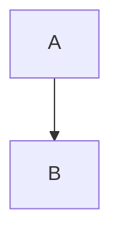

# Specimen

A writing sample for the editor. It keeps the same paper column and walks through the marks a note can carry.

## Emphasis

A sentence with *italic*, **bold**, and ***bold italic*** beside `inline code`. Two trailing spaces make a hard break  
and this line continues under it. A backslash does the same.\
The second line sits close, not as a new paragraph.

### Lists

- Oak
  - Acorn
  - Gall
- Birch

1. First
   1. Nested one
   2. Nested two
2. Second

#### Tasks

- [ ] Unchecked task
- [x] Checked task

##### Quote

> The river keeps the bend it cut last spring.
>
> > A quieter line, nested inside the first.

###### Rule

---

## Link and image

The [example link](https://example.com) sits in the sentence. Autolinks follow on their own lines.

<https://example.com/auto>

www.example.com


### Table

| Left | Center | Right |
| :--- | :----: | ----: |
| alder | ash | elm |
| fir | pine | yew |
| oak | birch | maple |

#### Strike

~~Removed in revision~~ and still readable.

##### Code

```cpp
int answer = 42;
const char *label = "specimen";
// fence language is part of the block
```

An indented block stays monospaced too:

    indented line

###### Inline HTML

<em>Emphasized</em> and <strong>strong</strong> from inline HTML, plus a safe <a href="https://example.com/html">HTML link</a>.

```math
E = mc^2
```



A footnote marker sits here[^note].

[^note]: The note can hold *markup* and stays with the page.
